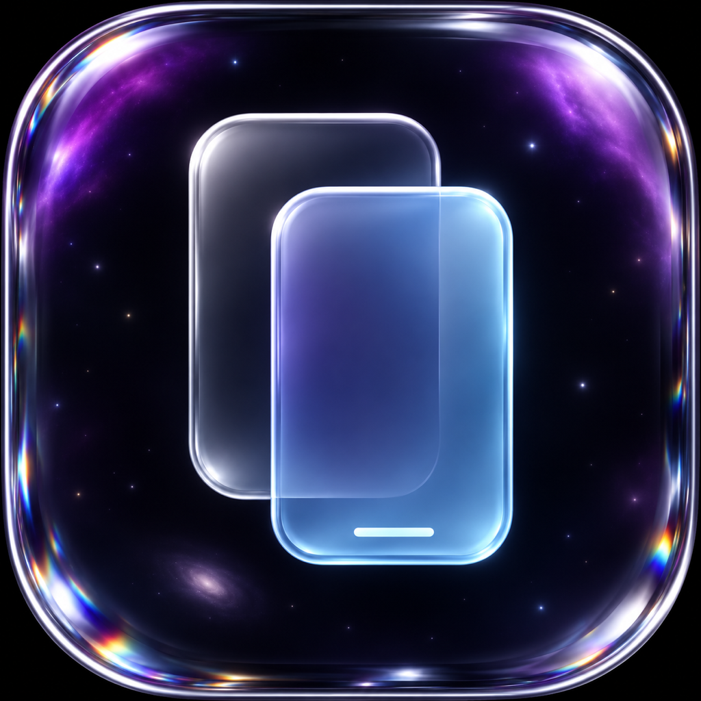

# iPhone Portal



**Getting this in the EU?**


Apple doesn't offer iPhone Mirroring in the EU. This app is the fix: it lets you see and control your iPhone from your Mac, just like iPhone Mirroring, wherever you are.

## Install

You need macOS 14+, full Xcode, Node 22.19+ and an Apple ID (a free one is fine).

1. Xcode → Settings → Accounts: add your Apple ID.
2. Plug in your iPhone, unlock it, tap **Trust**.
3. iPhone: Settings → Privacy & Security → **Developer Mode** → On.
4. Run:

```bash
git clone https://github.com/bare-metal-gpu/iphone-mirror && cd iphone-mirror
npm ci
npm run setup   # builds the helper app for your iPhone
npm run app     # installs "iPhone Portal" to ~/Applications
```

5. Open **iPhone Portal** and allow Camera and Microphone access when asked.
6. First launch only: on the iPhone, go to Settings → General → VPN & Device Management → trust your Apple ID.

## Use

Click to tap, drag to swipe, scroll to scroll, type to type.

Closing the mirror, choosing Quit in the Dock, or pressing ⌘Q leaves the menu-bar
watcher running in a separate native helper. Connect an iPhone to see its name and press the trailing play
button to mirror it. The menu-bar settings include **Open at Login** (starts only
the watcher) and **Quit iPhone Portal** (stops everything).

| Shortcut | Action |
| --- | --- |
| ⌘1 / ⌘2 / ⌘3 | Home / App Switcher / Spotlight |
| ⌘V | Paste your Mac clipboard |
| ⌘+ / ⌘− / ⌘0 | Window size |

Prefer the browser? Run `npm start` and open http://localhost:7100.

## Good to know

- Connect the iPhone by USB. Locking blurs the last frame; unlocking automatically restores control after a fresh frame arrives.
- With a free Apple ID, run `npm run setup` again every 7 days.
- The iPhone's sound plays on your Mac while mirroring.

The Mac app builds through `macos/iPhonePortal.xcodeproj` so Xcode compiles BorderBeamKit’s Metal shader and embeds its resources. The dependency tracks Libraries.dev’s `main` branch, with the resolved commit checked in. The phone window has 56-point corner resize targets with proportional sizing, and its loading background uses the same translucent blur as the toolbar. A border beam indicates startup, reconnecting, video loading, and pending input; it fades away when ready. The centered loading message pairs ThinkingOrbsKit’s `connecting` orb with shimmering Inter text on a transparent background. Inter is bundled with its SIL Open Font License. Reduce Motion uses static indicators. If Xcode reports a missing Metal Toolchain, install it once with `xcodebuild -downloadComponent MetalToolchain`.

## Automation API

The Effect 4 server supports validated input, selector-based taps and typing, UI/device inspection, screenshots, verified transitions, retry-safe command receipts, and timed keep-awake. Browser access checks and device selection happen automatically; no sign-in or pairing prompts are added. See [the API reference](docs/api.md) for routes, examples, errors, and real-phone verification.
